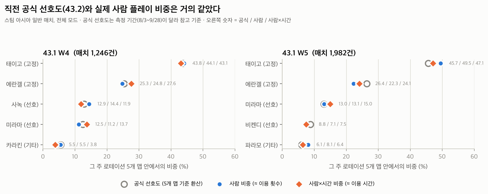
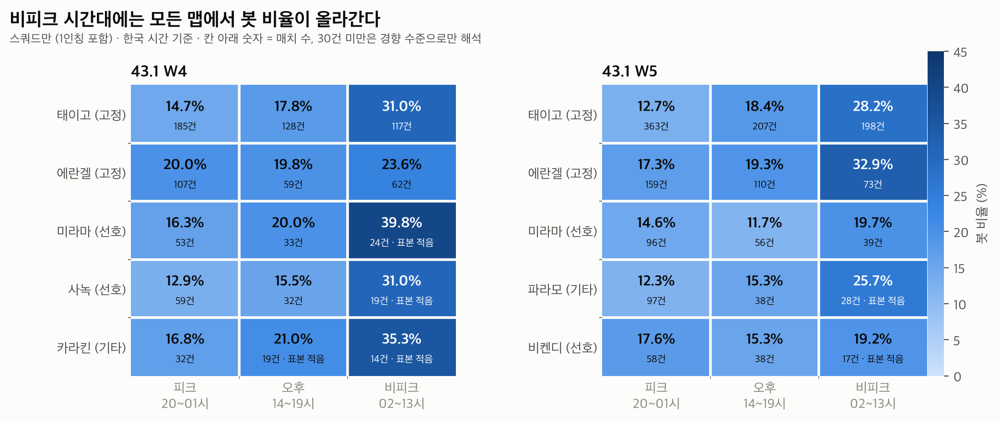

# 봇을 빼고 보면 PUBG 맵 선호도는 어떻게 보일까?
> 공식 API 매치 데이터로 다시 본 스팀 아시아 서버 (1주 프로젝트, 2026.10)

## 한 줄 요약
스팀 아시아 일반 매치 3,228건을 사람과 봇으로 나눠 분석했다. **직전 공식 맵 선호도는 실제 사람 플레이 비중과 거의 같았고(평균 차이 0.8~2.4%p), 봇 비율을 좌우한 건 맵이 아니라 시간대와 모드였다.** 그래서 로테이션 평가에 "시간대별 매칭 품질"을 보조 지표로 함께 보자고 제안한다.

📄 **전체 리포트: [outputs/report/report.md](outputs/report/report.md)**




## 왜 했나
- PUBG는 업데이트마다 지역별 "맵 선호도"(이용 시간·이용 횟수·선택률·이탈률 등 종합)를 공개하고, 이를 기준으로 고정·선호 맵을 정한다.
- 공식 선호도에는 **사람과 봇의 구분이 없다.** 첫 테스트에서 본 매치는 참가자의 77~94%가 봇이었다.
- 공식 지표에 없는 사람·봇 구분으로 맵 비중과 매칭 품질을 다시 보면 로테이션 결정에 쓸 근거가 나올지 확인했다.

## 발견 3가지
1. **공식 선호도는 사람의 플레이를 잘 반영했다.** 그 주 5개 맵 기준으로 환산한 선호도와 실제 사람 비중의 차이는 평균 0.8~2.4%p로, 매치 수 기준(1.9~2.7%p)보다 작았다.
2. **봇 비율은 맵보다 시간대와 모드가 좌우한다.** 스쿼드 봇 비율은 22시 13.3%에서 09시 39.0%까지 움직였지만, 같은 피크 시간대 안 맵 간 차이는 12.3~20.0%였다.
3. **기타(순환) 자리 맵의 매칭 품질은 선호 자리 맵과 비슷했다.** 단, 64명 정원을 고려해야 보인다. 정원 대비 사람 비율은 68.8~74.5%로 선호 자리 맵(65.6~76.2%)과 같은 범위였다.

## 제안
로테이션 평가에 선호도와 함께 **시간대별 매칭 품질(정원 대비 사람 비율)** 을 보조 지표로 보자. 피크에는 맵 간 차이가 없지만, 비피크에는 모든 맵의 봇 비율이 19~40%로 오른다.

## 한계 3가지
1. **기간·범위 차이:** 공식 선호도의 측정 기간(8/3 ~ 9/28)은 API 보관 기간(14일) 밖이라 같은 기간을 비교할 수 없다. 그래서 검증이 아닌 참고 비교다.
2. **표본:** samples 추출 방식이 비공개이고, 비피크 시간대의 맵별 칸은 14~39건이 많다.
3. **측정 불가 요소:** 선택률·이탈률, 직접 선택과 빠른 참가 구분, 플레이어 단위 이동은 측정할 수 없다.

## 데이터와 방법
| 항목 | 내용 |
|---|---|
| 데이터 | PUBG 공식 API (samples → matches), steam 샤드 |
| 기간 | 43.1 로테이션 W4·W5 (2026-10-02 08:35 ~ 10-14 11:00 KST) |
| 대상 | 일반 매치 + 아시아(as) 서버, 사람 0명 매치 제외 → **3,228건** |
| 지역 판별 | 매치 API에는 지역이 없어 텔레메트리 첫 16KB의 `MatchId`에서 지역 코드만 추출 |
| 사람·봇 구분 | `playerId` 앞부분 `account.` = 사람, `ai.` = 봇 |
| 비교 기준 | 공식 Map Service Report 43.1(로테이션)·43.2(맵 선호도) |
| 검증 | 무작위 매치를 API에서 다시 받아 12개 항목 대조 + 핵심 집계 칸 독립 재계산, 모두 일치 |

## 실행 방법
```bash
# 1) .env 파일에 PUBG_API_KEY=발급받은키 작성 (.env.example 참고)
# 2) 수집 (호출 제한을 지키며 약 30분)
python3 src/check_samples.py      # 날짜별 samples 매치 ID 저장
python3 src/collect.py            # 매치 조회 + 지역 판별 (중단 후 재실행 시 이어서 진행)
python3 src/add_survival.py       # 사람 생존 시간 추가 (collect.py로 새로 모은 데이터는 생략 가능)
# 3) 분석
python3 src/analyze_weekly.py && python3 src/analyze_by_mode.py
python3 src/analyze_by_band.py && python3 src/analyze_by_hour.py
python3 src/make_tables.py
python3 src/verify_sample.py 5    # 원본 대조 검증
# 4) 차트 (matplotlib 필요)
python3 -m venv .venv && .venv/bin/pip install -r requirements.txt
.venv/bin/python src/make_charts.py
```
API 데이터는 14일만 보관되므로, 같은 기간을 다시 수집할 수는 없다. 집계 결과는 `data/processed/`에 있다.

## AI와 일한 방식
- **나:** 문제 정의, 가설, 범위 결정, 도메인 지식을 이용한 검증, 해석과 결론
- **AI(Claude Code):** 수집·분석 코드 작성, 반복 작업, 차트, 초안 정리
- AI가 틀렸던 사례와 바로잡은 과정은 [docs/02_AI협업로그.md](docs/02_AI협업로그.md)에 있다. 예: API의 `duration`을 경기 시간으로 잘못 해석한 것을, "블루존 페이즈 합으로 최대 시간이 정해져 있다"는 게임 규칙으로 바로잡았다.
- 방향을 바꾼 결정과 이유는 [docs/03_의사결정기록.md](docs/03_의사결정기록.md)에 있다. 예: 공식 선호도의 측정 기간이 API 보관 기간과 겹치지 않음을 발견하고, 정답지에서 참고 기준으로 낮췄다.

## 폴더 구조
```
src/              수집·분석·검증·차트 코드
data/processed/   집계 데이터 (개인 정보 없음) + 로테이션 표
data/raw/         원본 응답 (닉네임 포함 → git 제외)
outputs/charts/   차트 PNG
outputs/report/   리포트, 최종 표
docs/             문제정의서, 작업일지, AI 협업 로그, 의사결정 기록, Day 1·2 테스트 기록
```

## 개인 정보와 보안
- API 키는 `.env`에서만 읽고 git에 올리지 않는다.
- 플레이어 닉네임·계정 ID는 결과물에 쓰지 않고, 사람·봇 수와 생존 시간 같은 집계 값만 쓴다.
