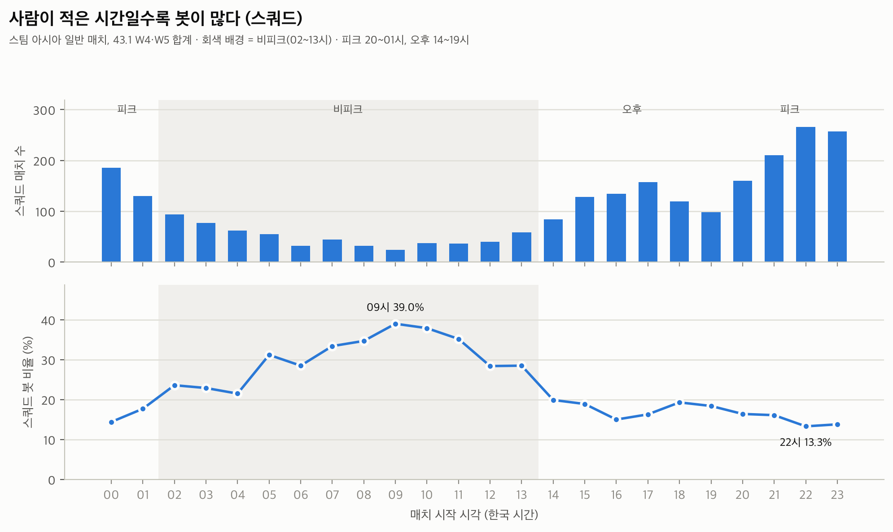

# 봇을 빼고 보면 PUBG 맵 선호도는 어떻게 보일까
### 공식 API 매치 데이터로 다시 본 스팀 아시아 서버 (2026.10)

> 초안 AI 작성(10/16) · 해석·표현 작성자 확정(10/17)

---

## 요약

- 스팀 아시아(AS) 서버 일반 매치 **3,228건**(43.1 로테이션 W4·W5, 10/2 ~ 10/14)을 PUBG 공식 API로 수집해, 주차별로 열린 5개 맵의 플레이 비중을 **사람과 봇으로 나눠** 계산했다.
- **봇 비율을 크게 좌우한 건 맵이 아니라 시간대와 모드였다.** 스쿼드 봇 비율은 22시 13.3% → 09시 39.0%로 움직였지만, 같은 피크 시간대 안에서 맵 간 차이는 12.3~20.0%에 그쳤다.
- **직전 공식 맵 선호도(43.2)를 그 주 5개 맵 기준으로 환산하면, 실제 사람 플레이 비중과 크게 다르지 않았다(평균 차이 0.8~2.4%p).** 사람 기준 지표가 매치 수 기준보다 공식 선호도에 더 가까웠다.
- 기타(순환) 자리 맵(카라킨·파라모)은 정원(64명) 대비 사람 비율이 선호 자리 맵과 같은 범위였다. 다만 비피크 시간대에는 모든 맵의 매칭 품질이 함께 떨어진다.
- 제안: 로테이션을 평가할 때 선호도와 함께 **시간대별 매칭 품질(정원 대비 사람 비율)** 을 보조 지표로 보자.
- 추가 제안: 큰 맵과 작은 맵의 선호도를 **따로 측정**하자(정원·경기 시간 차이로 작은 맵이 불리함). 작은 맵 1위인 **사녹의 고정 배치**는 아시아에서 시범 운영으로 검증하자.

---

## 1. 문제 정의

**배경**
- PUBG는 업데이트마다 Map Service Report로 지역별 "맵 선호도"를 공개하고, 이를 기준으로 고정·선호 맵을 정한다.
- 공식 설명: "맵 선호도는 이용 시간, 이용 횟수, 선택률, 이탈률 등 모든 모드에서 관찰되는 맵 이용 관련 다양한 요소를 종합적으로 분석하여 측정됩니다."
- 그런데 공개된 설명과 수치에는 **사람과 봇의 구분이 나와 있지 않다.** 첫 테스트에서 본 매치 2건은 참가자의 77%, 94%가 봇이었다.
- 개발자 서한(2026.4.29)은 맵 선택 도입 시 "일부 맵은 대기가 길어지거나 한 판 인원이 적어질 수 있다"고 우려했다.

**핵심 질문** (질문마다 가장 공정한 분석 기준을 따로 사용)

| 질문 | 분석 기준 |
|---|---|
| Q1. 주차별로 열린 5개 맵의 사람 기준 비중 순위는 직전 공식 선호도 순위와 같은 방향인가? | 전체 모드, 전체 시간대 |
| Q2. 봇을 빼면 맵 간 격차는 어떻게 되고, 선호 자리와 기타(순환) 자리 맵의 매칭 품질은 시간대에 따라 얼마나 다른가? | 스쿼드만 × 시간대 |
| 제안. 로테이션 편성에 함께 볼 매칭 품질 기준은? | 스쿼드만, 비피크 |

**처음 계획에서 바뀐 것**
- 원래는 공식 선호도를 "정답지"로 삼아 내 계산 방법을 검증하려 했다.
- 그런데 공식 측정 기간(8/3 ~ 9/28)과 API로 얻을 수 있는 기간(최근 14일)이 겹치지 않는다는 것을 발견했다.
- 그래서 공식 선호도를 "참고 기준"으로 낮추고, 공식 수치에 드러나지 않는 사람·봇 구분을 중심 질문으로 바꿨다. (docs/03_의사결정기록.md)

---

## 2. 데이터와 방법

**수집**

| 단계 | 건수 |
|---|---|
| steam 샤드 samples, 10/2 ~ 10/14 (13일, 날짜 간 중복 0) | 9,709 |
| 매치 조회 후 일반 매치 + 텔레메트리 지역 코드 `as` | 3,484 |
| 분석 기간: 43.2 로테이션 교체(10/14 11:00 KST) 이전 | 3,231 |
| 사람 0명 매치 제외 → **분석 대상** | **3,228** (W4 1,246 / W5 1,982) |

- **지역 판별:** 매치 API에는 지역 정보가 없다. 그래서 텔레메트리 파일의 첫 16KB만 받아 `MatchId`의 지역 코드(as, sea, eu …)를 읽었다. 파일 전체의 약 1%만 받으면 된다.
- **사람·봇 구분:** `playerId` 앞부분이 `account.`이면 사람, `ai.`이면 봇으로 봤다.
- **로테이션:** 공식 Map Service Report 43.1·43.2 원문에서 AS 주차별 로테이션 표를 확보했다. 수집한 매치의 맵이 모두 그 주 로테이션 안에 있었다(밖의 맵 0건).

**지표**

| 지표 | 정의 | 공식 요소와의 관계 |
|---|---|---|
| 사람 비중 | 그 주 해당 맵에 참가한 사람 수 ÷ 그 주 전체 사람 수 | ≈ 이용 횟수 |
| 사람×시간 비중 | 사람별 실제 생존 시간의 합의 비중 | ≈ 이용 시간 |
| 환산 선호도 | 공식 선호도(9개 맵 합 100%)를 그 주 열린 5개 맵끼리 다시 100%로 나눈 값 | 비교 기준 |
| 봇 비율 | 봇 수 ÷ 전체 참가자 수 | - |
| 정원 대비 사람 | 한 판 사람 수 ÷ 그 맵의 최대 인원(카라킨·파라모 64명, 나머지 100명) | 매칭 품질 |

- 시간대(한국 시간): 피크 20~01시, 오후 14~19시, 비피크 02~13시

**검증**
- 무작위로 고른 매치를 API에서 다시 받아 저장값 12개 항목을 대조했다.
- 핵심 집계 칸 5개는 분석 코드를 쓰지 않고 따로 다시 계산했다.
- 두 가지 모두 일치했다. (`src/verify_sample.py`)
- **오차 범위:** 각 칸의 매치를 중복 허용으로 다시 뽑아 2,000번 다시 계산하는 방법(부트스트랩)으로 핵심 숫자의 95% 범위를 구했다. (`src/bootstrap_ci.py`)

---

## 3. 결과

### Q1. 직전 공식 선호도와 실제 사람 플레이 비중은 크게 다르지 않았다

| 주차 | 환산 선호도와의 평균 차이: 사람 비중 | 사람×시간 비중 | 매치 비중(참고) | 순위 일치 (사람 비중 / 사람×시간) |
|---|---|---|---|---|
| W4 | 0.8%p (0.5~2.0) | 1.4%p (0.8~2.6) | 1.9%p | 5/5 · 3/5 |
| W5 | 2.4%p (1.6~3.3) | 1.5%p (0.8~2.4) | 2.7%p | 3/5 · 5/5 |

괄호는 95% 범위다. 오차를 고려해도 평균 차이는 최대 약 3%p 수준이었다.

- 상위 3개 맵의 순위는 두 주 모두 공식과 같았다. 순위가 바뀐 곳은 차이가 1~2%p인 이웃 맵 한 쌍뿐이었다(W4 사녹·미라마, W5 비켄디·파라모).
- 고정 맵 태이고는 공식 환산치보다 실제 사람 비중이 조금 높았다(W5 45.7% → 49.5%).
- 해석: 측정 기간이 달라 검증은 아니다. 다만 직전 공식 선호도를 그 주 5개 맵 기준으로 환산하면, 2~6주 뒤의 실제 사람 플레이 비중과 크게 다르지 않았다(평균 차이 0.8~2.4%p). 매치 수 기준보다 사람 기준 지표가 더 가까웠다.

### Q2. 봇 비율은 맵보다 시간대가 좌우했다

| 스쿼드 | 봇 비율 (맵 범위) | 정원 대비 사람 (맵 범위) | 칸당 매치 수 |
|---|---|---|---|
| 피크 20~01시 | 12.3 ~ 20.0% | 76.7 ~ 84.6% | 32 ~ 363 |
| 오후 14~19시 | 11.7 ~ 21.0% | 75.0 ~ 85.5% | 19 ~ 207 |
| 비피크 02~13시 | 19.2 ~ 39.8% | 58.3 ~ 77.7% | 14 ~ 198 |

- **피크·오후에는 맵 간 차이가 작다.** 기타(순환) 자리 맵도 선호 자리 맵과 같은 범위다.
- **비피크에는 10개 칸 모두에서 봇 비율이 피크보다 높았다.** 다만 오차 범위까지 고려해 "확실히 높다"고 말할 수 있는 곳은 6곳이다. 나머지 4곳은 표본이 작거나 차이가 작아 우연일 가능성을 배제할 수 없다.

| 비피크 − 피크 봇 비율 (스쿼드) | 차이 (95% 범위) | 비피크 매치 수 |
|---|---|---|
| W4 태이고 | +16.3%p (+9.9 ~ +22.9) ✓ | 117 |
| W4 미라마 | +23.5%p (+7.7 ~ +39.0) ✓ | 24 |
| W4 사녹 | +18.1%p (+1.2 ~ +36.2) ✓ | 19 |
| W4 카라킨 | +18.5%p (−2.0 ~ +40.0) | 14 |
| W4 에란겔 | +3.7%p (−5.0 ~ +12.4) | 62 |
| W5 태이고 | +15.4%p (+10.7 ~ +20.1) ✓ | 198 |
| W5 에란겔 | +15.6%p (+7.6 ~ +23.2) ✓ | 73 |
| W5 파라모 | +13.4%p (+0.3 ~ +27.8) ✓ | 28 |
| W5 미라마 | +5.2%p (−5.2 ~ +15.5) | 39 |
| W5 비켄디 | +1.5%p (−15.3 ~ +21.3) | 17 |

✓ = 95% 범위가 0보다 커서 "비피크에 확실히 높다"고 볼 수 있는 칸. 맵 사이 순서는 범위가 넓어 경향 수준으로만 본다.
- **모드 차이도 크다.** 맵별 봇 비율이 솔로 44~83%(173건), 듀오 24~53%(535건), 스쿼드 15~23%(2,520건)였다. 전체 모드 표에서 W4 미라마의 봇 비율이 32%로 높았던 것도, 스쿼드만 보면 22.6%로 다른 맵과 비슷하다.

---

## 4. 발견 3가지

1. **봇 비율의 차이는 맵보다 시간대와 모드에서 나온다.**
   - 스쿼드 봇 비율은 시간대에 따라 13.3%(22시, 95% 범위 10.8~16.0)에서 39.0%(09시, 26.6~51.4)까지 움직였다. 두 범위가 겹치지 않아 우연으로 보기 어렵다.
   - 비피크에는 10개 맵·주차 칸 모두에서 봇 비율이 피크보다 높았고, 그중 6곳은 오차 범위를 고려해도 확실했다.
   - 같은 피크 시간대 안에서 맵 간 차이는 12.3~20.0%였다.
   - 맵별 봇 비율은 솔로 44~83%, 스쿼드 15~23%로 모드 차이도 컸다.
   - "비인기 맵이라 봇이 많다"보다 "사람이 적은 시간·모드라 봇이 많다"가 데이터에 더 맞다.
2. **직전 공식 선호도는 실제 사람 플레이 분포와 크게 다르지 않았다.**
   - 직전 공식 선호도(43.2)를 그 주 5개 맵 기준으로 환산하면, 실제 사람 비중과 평균 0.8~2.4%p 차이였다.
   - 매치 수 기준(1.9~2.7%p)보다 사람 기준 지표가 더 가까웠다.
   - 공식 지표에 봇 구분은 명시되지 않았지만, 결과는 "사람의 이용"을 재는 지표와 같은 방향이었다.
   - 공식이 이미 봇을 빼고 측정하고 있을 가능성도 있다. 선택률·이탈률은 원래 사람의 행동이고, 사람 기준 지표가 더 가까웠기 때문이다. 그렇더라도 공개되는 것은 맵별 숫자 하나뿐이다. 봇이 어느 시간대·모드에 몰리는지(발견 1)와 맵별 매칭 품질(발견 3)은 공식 수치로 알 수 없다.
3. **기타(순환) 자리 맵의 매칭 품질은 선호 자리 맵과 비슷했다. 단, 정원을 고려해야 보인다.**
   - 카라킨·파라모는 한 판 사람 수가 44~48명으로 다른 맵(66~77명)보다 적어 보인다.
   - 하지만 최대 인원이 64명이라, 정원 대비 사람 비율은 68.8~74.5%로 선호 자리 맵(65.6~76.2%)과 같은 범위였다.
   - 오차 범위도 서로 겹친다. 예: W4 카라킨 68.8%(62.8~74.5) vs 미라마 65.6%(60.2~70.7), W5 파라모 74.5%(70.6~78.0) vs 비켄디 70.6%(65.3~75.9). 기타 자리 맵이 더 나쁘다고 볼 근거는 없었다.
   - 개발자 서한의 우려("한 판 인원이 적어질 수 있다")는 피크·오후 시간대에는 관찰되지 않았다.

**가설 점검**

| 가설 | 결과 |
|---|---|
| H1. 상위 2개 맵(태이고·에란겔)은 공식 순위와 같을 것 | 지지: 두 주, 모든 지표에서 1·2위 일치 |
| H2. 비인기 맵일수록 봇이 많아, 사람만 세도 순위는 유지되고 격차만 커질 것 | 부분 지지: 사람 비중의 순위는 매치 비중과 같았고, 태이고의 몫은 약 3%p 커졌음(W4 40.9 → 44.1%, W5 46.2 → 49.5%). 하지만 "비인기 맵일수록 봇이 많다"는 주차마다 달랐고, 스쿼드만 보면 맵 간 차이가 작음 |
| H3. 봇 비율은 맵보다 시간대의 영향이 클 것 | 지지: 시간대에 따른 변화(약 26%p)가 같은 시간대 안 맵 간 차이(약 8%p)보다 큼 |
| H4 (데이터를 본 뒤 세운 가설). 사녹이 없는 주에 작은 맵 선호 유저가 파라모를 대신 플레이 | 데이터와 맞는 방향이지만 확인 불가: 사람×시간 비중이 W5 파라모 6.4%, W4 카라킨 3.8%(공식 선호도는 4.6% vs 4.4%). 비켄디 약세 효과와 분리 불가, 플레이어 단위 추적은 범위 밖 |

---

## 5. 한계 3가지

1. **공식 선호도와 측정 기간·범위가 다르다.**
   - 공식은 8/3 ~ 9/28, 이 분석은 10/2 ~ 10/14다. API 보관 기간이 14일이라 공식 기간의 데이터는 구조적으로 구할 수 없다.
   - 공식은 "모든 모드"(경쟁전·캐주얼 포함 여부 불명), 이 분석은 일반 매치만 본다.
   - 그래서 Q1은 검증이 아니라 참고 비교다.
2. **표본이 작은 칸이 있다.**
   - samples의 추출 방식이 공개되지 않아 결과는 추정치다.
   - 비피크 시간대의 맵별 칸은 14~39건이 많아, 맵 사이 순서는 경향 수준이다. 부트스트랩 95% 범위도 넓다(예: W5 비켄디 비피크 − 피크 차이 −15.3 ~ +21.3%p).
   - W4는 7일 중 약 5일치만 있다.
3. **공식 요소 중 일부는 측정할 수 없다.**
   - 선택률과 이탈률은 API로 알 수 없다. 직접 선택과 빠른 참가도 구분할 수 없다.
   - 같은 유저가 맵을 옮겨 다니는지(H4)는 플레이어 단위 추적이 필요한데, 개인 정보라 범위에서 제외했다.

참고: API의 `duration`은 사람의 경기 시간이 아니라 마지막 봇이 사라질 때까지의 시간이었다(최대 500분). 그래서 경기 시간은 사람 최대 생존 시간(최대 29분)으로 대신 측정했다.

---

## 6. 제안

**로테이션을 평가할 때 선호도와 함께 "시간대별 매칭 품질(정원 대비 사람 비율)"을 보조 지표로 보자.**

- **근거 1:** 선호도는 이미 실제 사람 플레이 분포와 크게 다르지 않다(발견 2). 그래서 "어떤 맵을 넣을지"보다 **"그 맵이 사람이 적은 시간에도 한 판을 사람으로 채울 수 있는지"** 가 비어 있는 정보다.
- **근거 2:** 피크에는 기타 자리 맵도 매칭 품질이 선호 자리 맵과 같았다(발견 3). 반면 비피크에는 봇 비율이 19~40%로 오르고, 10개 칸 중 6곳은 오차 범위를 고려해도 확실한 상승이었다(발견 1).
- **실행안 예시:**
  - Map Service Report에 지역별 "비피크 정원 대비 사람 비율"을 함께 공개하거나 내부에서 모니터링한다.
  - 기타(순환) 자리 후보를 고를 때 비피크 값이 기준선(예: 고정 맵의 비피크 값) 아래로 떨어지는지 확인한다.
- **후속 검증:** 다음 Map Service Report의 선호도 측정 기간이 10월을 포함하면, 같은 기간끼리 비교해 이 분석의 방법을 검증할 수 있다.

### 추가 제안: 아시아 서버에서 큰 맵과 작은 맵을 나눠 측정하고, 사녹 고정을 시범 운영

**큰 맵과 작은 맵(사녹·파라모·카라킨)의 선호도를 따로 측정하자. 작은 맵끼리 1위인 사녹을 고정 자리에 넣는 방식은 유저 수가 가장 많은 아시아에서 시범 운영으로 검증하자.**
(구성 예: 큰 맵 고정 2개(태이고·에란겔) + 작은 맵 고정 1개(사녹) + 순환 2개)

**데이터 근거**
1. **작은 맵끼리 나누면 사녹은 압도적 1위다.**
   - 43.2 선호도를 작은 맵 3개(합 19.2%)끼리 환산하면 사녹 53%, 파라모 24%, 카라킨 23%다.
   - 현재 규칙(15% 이상만 고정)으로는 사녹(10.2%)이 고정이 될 수 없다.
2. **지금 지표는 작은 맵에 구조적으로 불리하다.**
   - 파라모·카라킨은 정원이 64명이고, 경기 시간도 짧다(사람 기준 파라모 20.7분, 카라킨 17.3분, 태이고 26.8분).
   - 그래서 이용 시간으로 재면 실제보다 낮게 나온다. 예: 파라모는 매치 비중 12.2%인데 사람×시간 비중은 6.4%다.
   - 크기가 다른 맵을 한 줄로 세우지 않고 따로 재면 이 불리함이 사라진다.
3. **반대 근거: 사녹이 빠진 주에 사녹 유저 대부분은 큰 맵으로 옮겨 갔다.**
   - 작은 맵의 사람 비중은 W4 19.9%(사녹 14.4 + 카라킨 5.5)에서 W5 8.1%(파라모)로 줄었다.
   - 다른 작은 맵이 늘어난 몫은 약 2.6%p뿐이고, 태이고가 5.4%p 늘었다.
   - "작은 맵만 하는 유저층"은 생각보다 작을 수 있다. 다만 그 유저들의 만족도나 이탈 여부는 API로 알 수 없다.

**장점과 단점**

| | 장점 | 단점 |
|---|---|---|
| **운영자** | 정원·경기 시간 차이로 작은 맵이 불리하던 측정을 보정 · 유저 풀이 가장 큰 아시아라 시범 운영 위험이 작고 주차별 효과 측정이 쉬움 · 짧은 판을 원하는 유저층을 항상 붙잡아 둠 | 순환 자리가 3개에서 2개로 줄어 미라마·비켄디·론도·데스턴의 노출 감소(새 맵 투자 효과가 덜 드러남) · "15% 이상만 고정" 규칙의 예외라 다른 지역·맵의 형평성 요구 · 근거 3대로라면 유지 효과가 작을 수 있음 |
| **유저** | 사녹 선호 유저는 언제든 플레이 · 시간이 부족한 유저에게 짧은 판 선택지가 항상 열림 · 작은 맵(64명)은 사람을 적게 모아도 판이 차서 비피크 매칭에 유리할 가능성 | 큰 맵 선호 유저에게는 로테이션이 단조로워짐 · 빠른 참가로 원치 않는 사녹에 들어갈 빈도 증가 · 매주 바뀌는 신선함 감소 |

**제안의 구성: 확실한 근거와 검증할 가설을 나눈다**
1. **측정 방식 개선 (근거 1·2로 바로 제안 가능):** 큰 맵과 작은 맵의 선호도를 따로 측정한다. 운영 방식은 그대로 두고 측정만 바꾸므로 위험이 없다.
2. **사녹 고정 시범 운영 (근거 3 때문에 검증 필요):** 아시아에서 몇 주간 운영하고 아래 기준으로 판단한다.
   - 작은 맵의 사람 비중
   - 비피크 시간대의 정원 대비 사람 비율
   - 순환 맵(미라마·비켄디 등)의 사람 비중 감소폭
   - 사녹 선호 유저의 이탈률 (내부 데이터 필요)

---

## 7. AI와 일한 방식

**역할 분담:** 나는 문제 정의, 가설, 범위 결정, 도메인 지식을 이용한 검증, 해석과 결론을 맡았다. AI(Claude Code)는 수집·분석 코드, 반복 작업, 차트, 초안 정리를 맡았다.

**사람이 바로잡거나 방향을 바꾼 순간**

| 순간 | 무엇이 문제였나 | 어떻게 바뀌었나 |
|---|---|---|
| 측정 기간 불일치 (내가 발견) | AI는 공식 선호도의 측정 기간(8/3 ~ 9/28)을 찾고도 "8주라 문제정의서와 맞다"고만 보고함. 내 데이터(10/2 ~ 10/14)와 겹치지 않는다는 점을 놓침 | Q1을 "정답지로 검증"에서 "참고 비교"로 바꾸고, 사람·봇 구분을 중심 질문으로 재설계 |
| `duration` 해석 오류 (AI 오류, 내가 지적) | AI가 50분 이상 매치 189건을 "비정상적으로 긴 매치"로 보고해 제외까지 진행됨. 나는 "블루존 페이즈 합으로 최대 시간이 정해져 있는데 50분 경기가 나올 수 없다"고 지적 | 원본 대조 결과 `duration`은 마지막 봇이 사라질 때까지의 시간이었음(사람 최대 생존은 최대 29분). 제외를 취소하고 경기 시간 지표를 교체. 같은 필드 때문에 틀렸던 다른 결론("파라모 경기 시간은 태이고와 비슷")도 정정 |
| "공식이 이미 봇을 빼고 있다면?" (내 질문) | 문서에 "공식 선호도에는 사람·봇 구분이 없다"고 단정함 | "공개 자료에 나와 있지 않다"로 정정하고, 그래도 프로젝트가 성립하는 이유(봇의 시간대·모드 분포는 비공개)를 리포트에 명시 |
| 게임 규칙 (내 도메인 지식) | sea는 별도 서버, 경쟁전은 사람만 최대 64명, 캐주얼은 봇 고정 구성. 카라킨·파라모의 한 판 인원이 약 61명인 것은 AI가 숫자에서 발견했고, 정원 64명이라는 규칙은 내가 확인 | 분석 범위(as만, 일반 매치만)와 "정원 대비 사람 비율" 지표에 반영. 정원 차이를 놓쳤다면 "기타 자리 맵은 매칭 품질이 나쁘다"는 잘못된 결론이 나올 뻔함 |

**결과를 믿기 위해 한 검증**
- **원본 대조:** 무작위 매치를 API에서 다시 받아 저장값 12개 항목을 비교했다.
- **독립 재계산:** 핵심 집계 칸은 분석 코드를 쓰지 않고 따로 다시 계산해 일치를 확인했다.
- **오차 범위:** 부트스트랩으로 핵심 숫자의 95% 범위를 구했다. 그 결과 "비피크에 모든 맵의 봇이 오른다"는 표현을 "10곳 모두 올랐고 그중 6곳은 확실"로 고쳤다.
- **차트·PDF 확인:** 렌더링 결과를 직접 열어 겹침과 잘림을 확인했다.
- **반대 근거 함께 제시:** 제안에는 반대 근거도 함께 적었다(사녹이 빠진 주에 유저 대부분이 큰 맵으로 이동).

**배운 점:** AI는 코드와 계산은 빠르고 정확했지만, **숫자가 게임 규칙과 맞는지, 비교 기간이 맞는지 같은 "전제"는 사람이 의심해야 잡혔다.** API 필드 이름을 그대로 믿지 않고 도메인 지식으로 다시 확인하는 것이 가장 중요한 검증이었다.

---

## 부록

- 전체 표: [final_tables.md](final_tables.md)
- 문제 정의 변천과 결정 이유: [docs/03_의사결정기록.md](../../docs/03_의사결정기록.md)
- AI가 틀렸던 사례와 바로잡은 과정: [docs/02_AI협업로그.md](../../docs/02_AI협업로그.md)
- 재현 방법: README의 "실행 방법"
